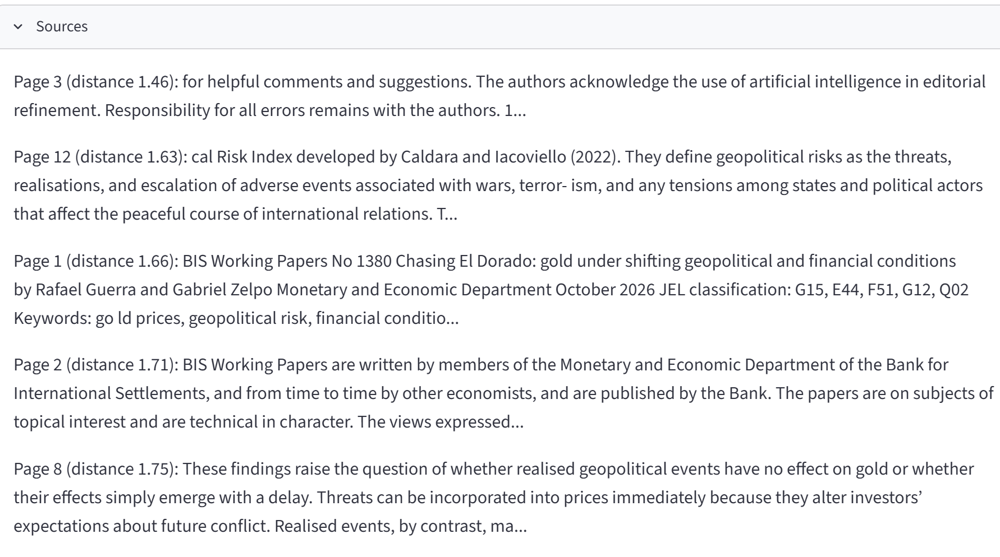

# Banking Document Assistant (RAG)

A "chat with your PDF" app. It answers questions only from the uploaded document and cites page numbers. Built with LangChain, Chroma, Hugging Face embeddings, Google Gemini and Streamlit.

Test document: BIS Working Paper No 1380 (public, available on bis.org). The PDF is not included in this repo.


## How it works
1. Load the PDF page by page (PyPDFLoader)
2. Split into overlapping chunks ([S] characters, [O] overlap; 110 chunks for the 44-page test paper)
3. Embed each chunk with all-MiniLM-L6-v2 (384-dimensional vectors)
4. Store the vectors in Chroma
5. For each question, retrieve the top-k most similar chunks
6. Send the chunks and question to Gemini with a grounded prompt: answer only from the context, cite pages, refuse if the answer is not there
7. Show the answer with its sources in a Streamlit chat interface

## Evaluation
I built a hand-labelled test set of 18 questions on one document (`eval/test_set.csv`): factual, numeric, synthesis, vague, misattribution and out-of-scope questions.

Retrieval only (is a correct page among the retrieved chunks? 13 answerable questions):

| top-k | hit rate |
|---|---|
| 3 | 10/13 |
| 5 | 11/13 |
| 8 | 12/13 |

Full pipeline at k=8, graded by hand on all 18 questions: average score 0.94 out of 1 (16 of 18 answers fully correct, 2 partly correct).
Out-of-scope questions correctly refused: 5/5.

## Findings
- k=3 missed answers that are spread across several pages. k=8 recovered most of them.
- Specific questions retrieve much better than vague ones. "What data and methods do the authors use?" failed at first, while the more specific "What is the sample period and frequency of the data?" worked.
- Hardest case: "What methods do the authors use?" The literature review uses the word "methods" heavily, so the retriever misses the authors' own method section (pages 9 to 11). I kept this question in the test set as a known limitation.
- I added a prompt rule so the model does not present other researchers' work as the paper's own.
- The model refused out-of-scope questions with the required sentence, even ones it could have answered from general knowledge.
- The two chunk sizes tied on hit rate, but different questions failed at each. For example, the data sample-period question needed k=8 at [S]/[O]. I kept [S]/[O] because the full evaluation had already been run on it.

## Limitations
- One document and 18 questions is a small sample. I tuned settings on the same questions, so the scores are likely optimistic.
- I corrected parts of the answer key after checking the source PDF. All changes are logged in `test_log.md`.
- No conversation memory: each question is searched on its own.
- Scanned PDFs and tables are not supported.
- The free Gemini tier limits daily requests, which limits how often the full evaluation can run.

## Run it locally
```
python -m venv venv
venv\Scripts\activate
pip install -r requirements.txt
```
Create a `.env` file containing `GOOGLE_API_KEY=your_key_here`, then:
```
streamlit run app.py
```
To reproduce the evaluation, download the paper to `data/sample.pdf`, then run:
```
python embed_and_search.py
python evaluate.py 8 --retrieval-only
python evaluate.py 8
```

## Files
- `app.py`: the Streamlit app
- `rag_answer.py`: retrieval + answer pipeline
- `embed_and_search.py`: builds the vector store
- `evaluate.py`: runs the test set
- `eval/`: test set, results and test log

## Author
Rohit Kumar Yadav: [LinkedIn](https://www.linkedin.com/in/rky197/) | [GitHub](https://github.com/Rohit-dot-com)